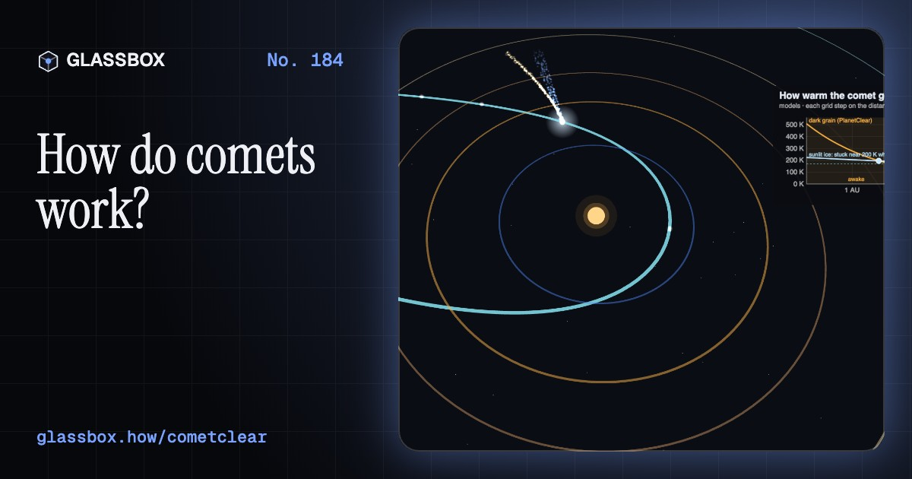
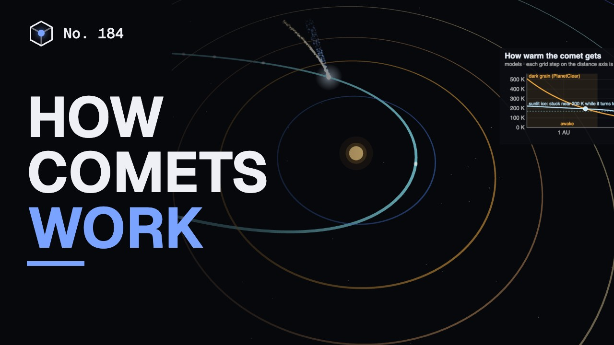
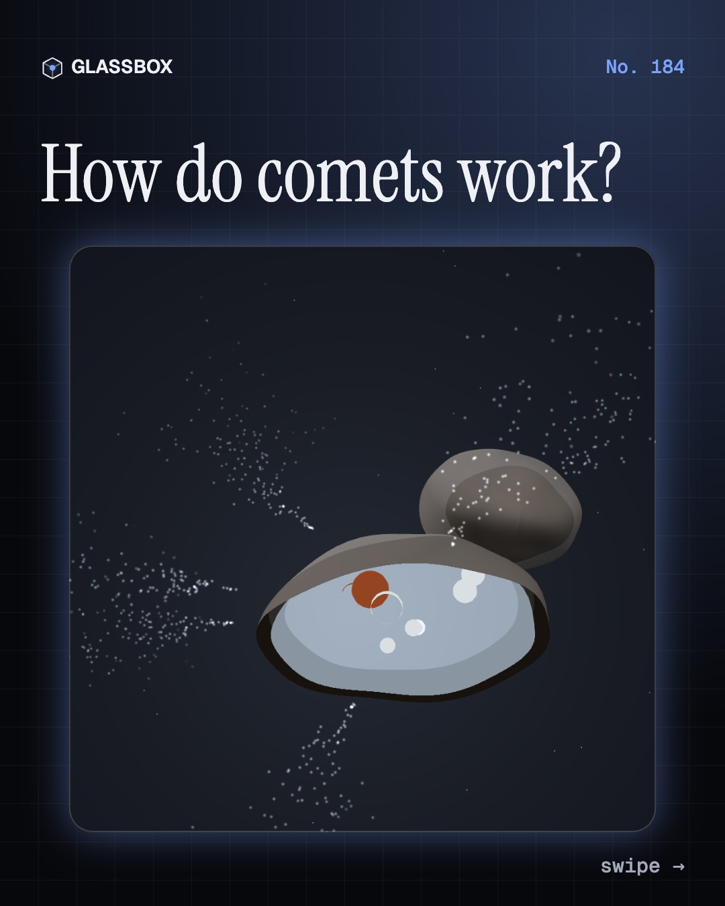
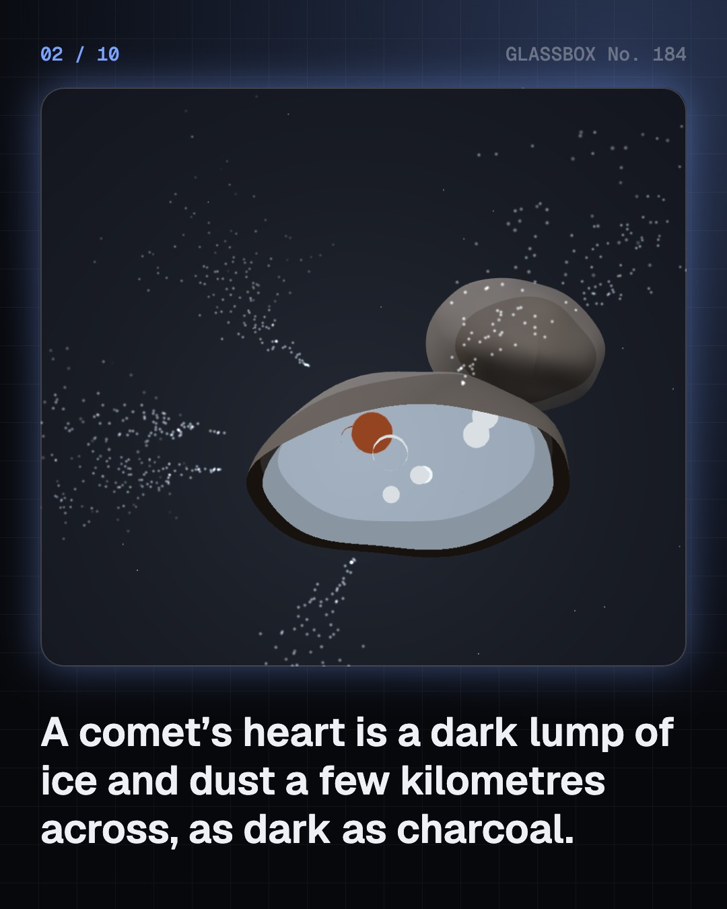
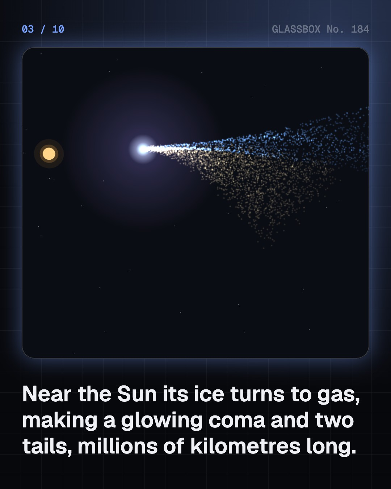
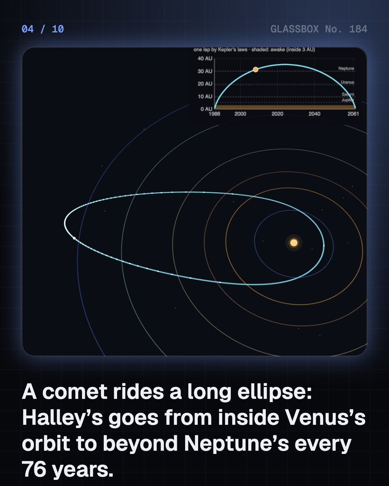

<!-- glassbox:start -->
<!-- Generated from glassbox.json by the Glassbox hub (npm run readme -- cometclear). Edit glassbox.json, not this block. -->
<p align="center"><a href="https://glassbox.how/e/cometclear/"></a></p>

<h1 align="center">CometClear</h1>

<p align="center"><b>How do comets work?</b><br>A comet is a dark lump of dusty ice a few kilometres across that spends decades frozen in the dark. Ride Halley's comet along its real orbit, watch the ice wake up inside 3 AU, push dust grains with sunlight, blow the ion tail with the solar wind, and follow the dust down to the Perseids.</p>

<p align="center"><a href="https://glassbox.how/cometclear/"><b>▶ Play with it</b></a> &nbsp;·&nbsp; <a href="https://glassbox.how/e/cometclear/">Read the 60-second explainer</a> &nbsp;·&nbsp; <a href="https://glassbox.how/cometclear/glassbox/reel.mp4">Watch the 40-second video</a></p>

<p align="center">
  <a href="https://glassbox.how/e/cometclear/"></a>
  <a href="https://glassbox.how/e/cometclear/"></a>
  <a href="LICENSE"></a>
  <a href="LICENSE-CONTENT.md"></a>
  <a href="#privacy"></a>
</p>

## In 60 seconds

1. **A dirty snowball with a dark crust.** The nucleus is a few kilometres of ice, dust and dark organic material. Rosetta's comet 67P is two lobes, about 4.1 km and 2.5 km long, weighs 1.0 × 10¹³ kg and is only half as dense as ice. Its gravity is so weak that a 50 kg student would weigh as much as about 1 g on Earth, and its escape speed is under 1 m/s.
2. **A long ellipse and a wake-up.** Halley's comet rides a needle-thin ellipse (a = 17.93 AU, e = 0.968, JPL) from 0.57 AU to 35 AU. By Kepler's second law it passes the Sun at about 55 km/s and crawls at under 1 km/s far out. A dark grain at 1 AU settles at 278 K, the same sum as PlanetClear's frost line. Inside about 3 AU sunlit ice sublimates fast, so Halley is awake for only about a year of each 76-year lap.
3. **Two tails, two pushes.** Neither tail trails behind like smoke. Charged gas is swept straight out by the solar wind at about 400 km/s, so the blue ion tail points almost exactly away from the Sun. Dust is pushed by sunlight itself: for a 10 µm grain the push is about 6% of gravity, so grains drift onto their own orbits and fan into a curved yellow tail. Going out, both tails lead the comet.
4. **Homes and endings.** Comets are leftover planetesimals. Jupiter-family comets come from the Kuiper belt and scattered disc; long-period comets fall in from the distant Oort cloud. They fade, break up like Shoemaker–Levy 9, which Jupiter tore apart in 1992 and swallowed in 1994, or dive into the Sun. Their dust gives meteor showers: computed from Swift–Tuttle's orbit, the Perseids hit the air at 59 km/s.
5. **Water, life and danger.** Rosetta found more than three times Earth's heavy-hydrogen ratio in 67P's water, though comets Hartley 2 and 46P/Wirtanen match the oceans and a 2024 reanalysis questions 67P's value. Comet dust carries glycine. NASA says no known asteroid larger than 140 m has a significant chance to hit Earth for the next 100 years, and DART showed in 2022 that a push works on an asteroid.
6. **Seeing and naming.** Every 5 magnitudes is 100 times in brightness. A fuzzy comet needs a dark sky; binoculars add about 4.3 magnitudes. C/1995 O1 means a non-periodic comet, the first found in the second half of July 1995: Hale–Bopp.

## Words worth knowing

| Term | Meaning |
|---|---|
| **Nucleus** | The solid heart of a comet: a few kilometres of ice, dust and organic material with a dark crust. |
| **Sublimation** | Ice turning straight into gas, as comet ice does in sunlight inside about 3 AU. |
| **Coma** | The cloud of gas and dust round a warming nucleus, hundreds of thousands of kilometres across. |
| **Ion tail** | Charged gas swept straight away from the Sun by the solar wind. It glows blue. |
| **Dust tail** | Dust pushed by sunlight, curved along the orbit and yellowish-white in reflected light. |
| **Radiation pressure** | The push of light. For a dust grain, β is that push divided by the Sun's gravity. |
| **Oort cloud** | A vast, round swarm of icy bodies thousands to perhaps 100,000 AU away: the home of long-period comets. |
| **Kuiper belt** | A flat ring of icy bodies beyond Neptune, about 30 to 50 AU out, source of Jupiter-family comets. |
| **Meteor shower** | Shooting stars from a comet's old dust as the Earth runs through it. |

## A short history

**From omens on clay tablets and palm-leaf texts to a spacecraft landing on a comet and visitors from other stars.**

- **240 BCE** · China records Halley's comet (Court astronomers of the Qin state, China)
- **1577** · Tycho puts a comet beyond the Moon (Tycho Brahe, Hven)
- **1705** · Halley predicts a return (Edmond Halley, Oxford)
- **1758** · The comet comes back (Johann Georg Palitzsch; Alexis Clairaut, Jérôme Lalande and Nicole-Reine Lepaute, Dresden and Paris)
- **1950** · The dirty snowball (Fred Whipple, Harvard, Cambridge, Massachusetts)
- **1986** · The Halley armada (ESA, the Soviet Union and Japan, Space, near Halley's comet)
- **1994** · Comet pieces hit Jupiter (Carolyn and Eugene Shoemaker, David Levy, Jupiter)
- **2014** · Rosetta arrives and Philae lands (ESA, with DLR and other partners, Comet 67P/Churyumov–Gerasimenko)

The full story, with 31 moments, charts, people and 45 sources: [glassbox.how/e/cometclear/history](https://glassbox.how/e/cometclear/history/). The data lives in [`history.json`](history.json).

## Video and slides

Made with the Glassbox studio from this box's storyboard (`window.glassbox.director`). Free to reuse under CC BY 4.0.

<a href="https://glassbox.how/cometclear/glassbox/video.mp4"></a>

<p><a href="glassbox/slide-1.jpg"></a> <a href="glassbox/slide-2.jpg"></a> <a href="glassbox/slide-3.jpg"></a> <a href="glassbox/slide-4.jpg"></a></p>

| File | What | Size |
|---|---|---|
| [`glassbox/reel.mp4`](https://glassbox.how/cometclear/glassbox/reel.mp4) | Reel / Short, with captions and soundtrack | 1080×1920 |
| [`glassbox/video.mp4`](https://glassbox.how/cometclear/glassbox/video.mp4) | YouTube video, with captions and soundtrack | 1920×1080 |
| `glassbox/slide-1…10.jpg` | Instagram carousel | 1080×1350 |
| `glassbox/thumb.jpg` | YouTube thumbnail | 1280×720 |
| `glassbox/cover.jpg` | Share card and repo social preview | 1200×630 |
| [`glassbox/history-reel.mp4`](https://glassbox.how/cometclear/glassbox/history-reel.mp4) | “History in 10 moments” Reel / Short | 1080×1920 |
| `glassbox/history-slide-*.jpg` | History carousel | 1080×1350 |
| `glassbox/post.json` | Post copy and schedule used by the publish kit | |

## Privacy

This box has no accounts and no ads, and it ships its own fonts and libraries. When you run it yourself it sends nothing anywhere. On glassbox.how, the site's `/bar.js` also loads Glassbox's analytics: **Google Analytics** to count visits (it asks first in the EU, UK and Switzerland, and stays off when your browser sends Global Privacy Control or Do Not Track) and **ClickTrust** to detect bots.

It remembers a few things **in your own browser only**, and never sends them anywhere:

| Browser storage key | What it holds |
|---|---|
| `cometclear.v1` | Which chapters you have opened, your best quiz scores, and sound on or off. |

Exactly what each one sees is at [glassbox.how/privacy](https://glassbox.how/privacy/).

## Licences

- **Code:** [MIT](LICENSE). Use it, change it, ship it.
- **Explanations, text, images and videos** (`glassbox.json`, `glassbox/`): [CC BY 4.0](LICENSE-CONTENT.md). Credit “Glassbox, glassbox.how/e/cometclear”.
- **Third-party parts** keep their own licences: [three.js](https://threejs.org) (MIT), [Geist, Instrument Serif](https://openfontlicense.org) (SIL OFL 1.1).
- The Glassbox name and logo aren't covered by either licence. See the [terms](https://glassbox.how/terms/).

Found a mistake? [Open an issue](https://github.com/bdeeps/cometclear/issues). Corrections happen in public.
<!-- glassbox:end -->

## Run it

It's plain HTML, CSS and JavaScript. No build step and no dependencies. Run locally, it contacts no other website.

```bash
python3 -m http.server 8000
```

Three.js and the fonts ship in `vendor/` and `fonts/`, so it also works offline.

Then open http://localhost:8000.

## How it's built

| File | What |
|---|---|
| `index.html`, `css/app.css` | The page and its styles |
| `js/app.js`, `js/stage.js`, `js/ui.js`, `js/kit.js` | The shared Glassbox 3D engine: chapters, 3D stage, controls, quiz, video director |
| `js/chapters/*.js` | One file per chapter: the 3D model, controls, text, key terms, quiz and video scenes |
| `js/comet.js` | Shared comet physics and parts: JPL orbits, Kepler's equation (from KeplerClear), the grain temperature (from PlanetClear), the ice-sublimation energy balance, radiation-pressure β, meteor-stream geometry, chart boards and the 67P-shaped nucleus |
| `glassbox.json` | Title, question, explainer beats, key terms, browser storage and credits shown on glassbox.how |
| `reel` in each chapter | The storyboard the Glassbox studio records into short videos |
| `glassbox/` | The published video, slides, thumbnail and post copy |
| `fonts/`, `vendor/three/` | Self-hosted Geist and Instrument Serif (SIL OFL 1.1) and three.js (MIT) |
